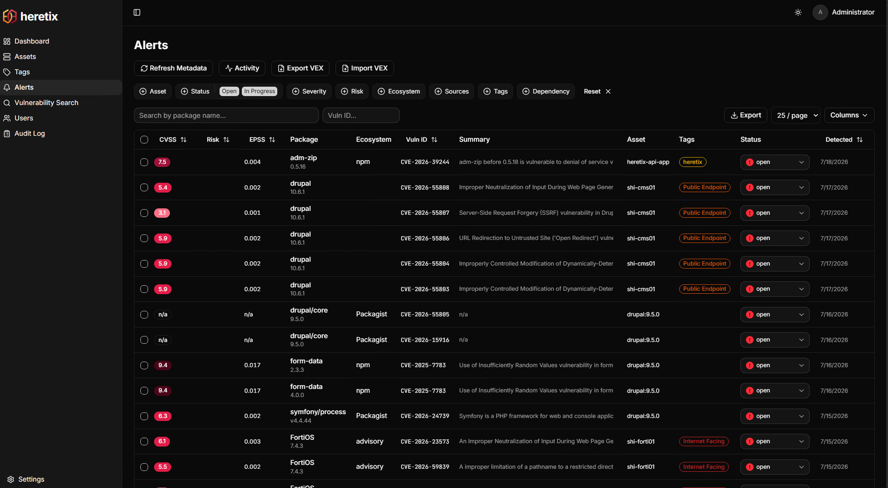
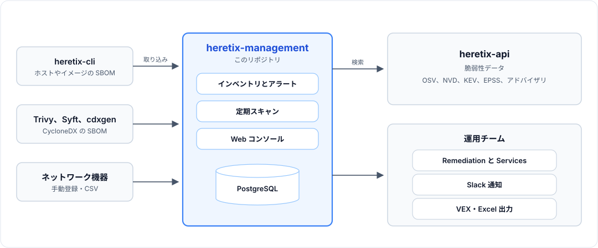

# heretix-management

heretix-management は、**[heretix](https://titeee.github.io/heretix-web/)** の Web コンソールです。heretix は、サーバー・コンテナ・ネットワーク機器（ファイアウォール、VPN など）の CVE を 1 つのインベントリで管理する、セルフホスト型のツール群です（Apache-2.0）。

[English README](README.md)



## 概要

各アセットに入っているソフトウェアを管理し、その脆弱性を見つけて、対応までを 1 か所で進められます。

1. **取り込み**: サーバーやコンテナイメージの SBOM を取り込みます。ネットワーク機器は、手入力か CSV で登録します。
2. **スキャン**: すべてのパッケージを heretix-api と照合し、該当するものをアラートにします。スキャンは、手動での実行、CI からのアップロード後、3 時間ごとの定期実行で動き、該当しなくなったアラートは自動で閉じます。
3. **対応**: アラートごとに、実際に悪用されているか（CISA KEV）、悪用される可能性（EPSS）、修正バージョン、回避策を確認できます。重要な資産やインターネットに公開している資産にはタグを付けておけば、急ぐべきものを見分けられます。



- **[heretix-cli](https://github.com/TITeee/heretix-cli)**: ホストやイメージの SBOM を作成します。
- **heretix-management**（このリポジトリ）: インベントリとアラートを管理します。
- **[heretix-api](https://github.com/TITeee/heretix-api)**: スキャンで照合する脆弱性データ（OSV、NVD、KEV、EPSS、ベンダーアドバイザリ）を保持します。

## 機能

- **インベントリ**: heretix-cli・Trivy・Syft・cdxgen の SBOM、手動または CSV での機器登録、アセットごとのパッケージ変更履歴
- **Remediation**: アセットのアラートを、修正に必要な変更ごとにまとめて表示。修正がまだないものは別のグループに分けて表示
- **Services**: heretix-cli の `collect` で収集したホストで、脆弱なコードを動かしているサービスと、更新後に再起動が必要なサービスを確認
- **優先順位付け**: CISA KEV、EPSS、SLA の期限、ディストロ自身の評価と修正状況
- **依存グラフ**: 脆弱なパッケージに依存しているものを確認
- **そのほか**: VEX *(Beta)*、Excel / JSON 出力、Slack、タグ、ユーザー管理と監査ログ、アクセストークンを使った CI からのアップロード

## 必要なもの

- **データの取り込みが済んだ [heretix-api](https://github.com/TITeee/heretix-api)** と、その API キー。heretix-management 自体は脆弱性データを持ちません。
- **Docker** と Docker Compose v2、git。
- 利用者のブラウザから heretix-management のポート 3000 に、heretix-management から heretix-api のポート 5000 に接続できること。

heretix-management 自体は軽量です。サーバーの規模は heretix-api に合わせてください（[heretix の要件](https://titeee.github.io/heretix-web/docs/)）。Docker を使わずに動かす場合は [docs/operations.md](docs/operations.md#running-without-docker) を参照してください。

## クイックスタート

先に heretix-api を、[そのクイックスタート](https://github.com/TITeee/heretix-api/blob/main/README.ja.md)の手順 3 まで進め、`API_KEY` を控えておきます。初回の NVD の取り込みには数時間かかりますが、その間にこちらの手順を進めて構いません。

### 1. 設定する

```bash
git clone https://github.com/TITeee/heretix-management.git
cd heretix-management
cp .env.example .env
```

`.env` に次を設定します。

| 変数 | 値 |
|---|---|
| `AUTH_SECRET` | ランダムな文字列（`openssl rand -base64 32` で生成） |
| `AUTH_URL` | 利用者がブラウザで開く URL（例: `http://192.0.2.10:3000`）。このサーバー上のブラウザだけで使う場合を除き、`localhost` は指定しない |
| `HERETIX_API_KEY` | heretix-api の `API_KEY` |
| `POSTGRES_PASSWORD` | 同梱のデータベースに設定するパスワード（任意の値） |

heretix-api が同じサーバーにあれば、ほかの設定は不要です。別のサーバーにある場合は、`HERETIX_API_URL` も設定します。

### 2. 起動する

```bash
docker compose up --build -d
docker compose exec app node_modules/.bin/tsx prisma/seed.ts   # 管理者ユーザーを作成
```

2 つ目のコマンドは、管理者ユーザーのパスワードを**一度だけ**表示します。

```text
Created user: admin@example.com
Generated password (shown only now; change it on the Users page): <24 文字>
```

これをコピーしたうえで、`AUTH_URL` を開いてサインインします。控え忘れた場合は [docs/operations.md](docs/operations.md#the-admin-password-was-lost) を参照してください。

### 3. 最初のアセットをスキャンする

1. **Settings → Vulnerability API → Test Connection** で、heretix-api への接続を確認します（[失敗する場合](docs/operations.md#test-connection-fails)）。
2. [heretix-cli](https://github.com/TITeee/heretix-cli/releases/latest) か Syft で SBOM を作ります。

   ```bash
   heretix-cli collect --image myapp:1.0 --name myapp --output sbom.json   # コンテナイメージ
   sudo heretix-cli collect --output sbom.json                             # このサーバー
   syft myapp:1.0 -o cyclonedx-json=sbom.json                              # または Syft
   ```

3. **Assets → Import SBOM** で取り込み、作成されたアセットで **Run Scan** を押します。

heretix-api にデータがない製品は検出されません。ディストロのパッケージを検出するにはそのディストロのデータが、ネットワーク機器を検出するにはそのベンダーのアドバイザリが、heretix-api に取り込まれている必要があります。

### 停止と更新

```bash
docker compose down                        # 停止（データは残る。-v を付けると削除）
git pull && docker compose up --build -d   # 更新（データベースの移行は起動時に自動で適用）
```

## ドキュメント

| ドキュメント | 内容 |
|---|---|
| [docs/importing-assets.md](docs/importing-assets.md) | SBOM の取り込み、機器の CSV 登録、パッケージの手動登録、CI からのアップロード |
| [docs/alerts.md](docs/alerts.md) | スキャン、アラート、重要度と SLA、Remediation、Services、VEX、通知 |
| [docs/operations.md](docs/operations.md) | Docker を使わない構築、環境変数、更新、バックアップと復元、定期ジョブ、トラブルシューティング |
| [docs/tls-proxy.md](docs/tls-proxy.md) | HTTPS でコンソールを公開する方法 |
| [docs/api.md](docs/api.md) | `/api/*` のエンドポイント一覧 |
| [docs/architecture.md](docs/architecture.md) | コードの構成と主なロジックの場所 |

## ライセンス

Apache License 2.0。詳細は [LICENSE](LICENSE) を参照してください。
