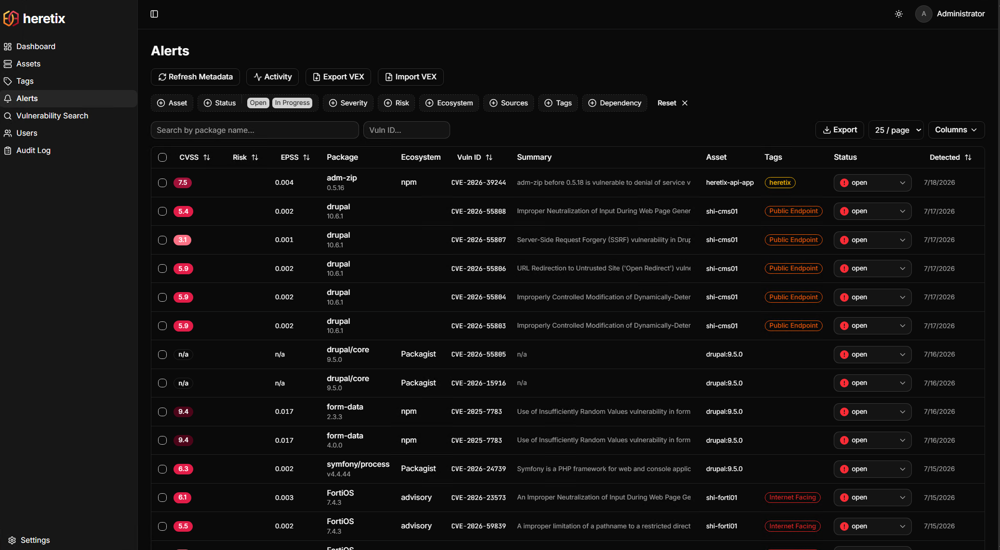

# heretix-management

heretix-management is the web console of **[heretix](https://titeee.github.io/heretix-web/)**, a self-hosted suite that tracks CVEs across servers, containers and network appliances (firewalls, VPNs) in one inventory (Apache-2.0).

[日本語版 README](README.ja.md)



## What it does

It keeps what each of your assets has installed, finds the vulnerabilities in it, and gives your team one place to work through them:

1. **Import** an SBOM of a server or container image, or register a network appliance by hand or by CSV.
2. **Scan**: every package is checked against heretix-api, and each match becomes an alert. Scans run on demand, after an upload from CI, and every three hours, and close the alerts that no longer apply.
3. **Fix**: alerts are grouped by the update that resolves them, with known-exploited (CISA KEV) ones first, SLA due dates, and Slack notifications.


- **[heretix-cli](https://github.com/TITeee/heretix-cli)** writes the SBOM of a host or image.
- **heretix-management** (this repository) keeps the inventory and the alerts.
- **[heretix-api](https://github.com/TITeee/heretix-api)** holds the vulnerability data (OSV, NVD, KEV, EPSS, vendor advisories) that every scan searches.

## Features

- **Inventory**: SBOMs from heretix-cli, Trivy, Syft or cdxgen, appliances by hand or CSV, and each asset's package history
- **Remediation**: an asset's alerts grouped by the change that fixes them, and the ones with no fix yet in groups of their own
- **Services**: for a host collected by heretix-cli, which services run the vulnerable code, and which need a restart after an upgrade
- **Prioritization**: CISA KEV, EPSS, SLA due dates, the distro's own rating and fix status
- **Dependency graph**: what depends on a vulnerable package
- **And**: VEX *(Beta)*, Excel / JSON export, Slack, tags, users and an audit log, uploads from CI with an access token

## Requirements

- A running **[heretix-api](https://github.com/TITeee/heretix-api) with its data loaded**, and its API key. heretix-management has no vulnerability data of its own.
- **Docker** with Docker Compose v2, and git.
- Users reach port 3000; heretix-management reaches heretix-api's port (5000).

heretix-management itself is light: size the server for heretix-api ([heretix requirements](https://titeee.github.io/heretix-web/docs/)). To run without Docker, see [docs/operations.md](docs/operations.md#running-without-docker).

## Quick start

Set up heretix-api first, through step 3 of [its quick start](https://github.com/TITeee/heretix-api#quick-start), and note its `API_KEY`. Its first NVD import takes hours; you can carry on here meanwhile.

### 1. Configure

```bash
git clone https://github.com/TITeee/heretix-management.git
cd heretix-management
cp .env.example .env
```

Set these in `.env`:

| Variable | Value |
|---|---|
| `AUTH_SECRET` | A random secret: `openssl rand -base64 32` |
| `AUTH_URL` | The URL users open, e.g. `http://192.0.2.10:3000` (not `localhost`, unless only this server's browser is used) |
| `HERETIX_API_KEY` | heretix-api's `API_KEY` |
| `POSTGRES_PASSWORD` | A password of your own for the bundled database |

With heretix-api on the same server, nothing else is needed. If it runs elsewhere, also set `HERETIX_API_URL`.

### 2. Start

```bash
docker compose up --build -d
docker compose exec app node_modules/.bin/tsx prisma/seed.ts   # create the admin user
```

The second command prints the admin user's password **once**:

```text
Created user: admin@example.com
Generated password (shown only now; change it on the Users page): <24 characters>
```

Copy it, open your `AUTH_URL`, and sign in. Lost it? See [docs/operations.md](docs/operations.md#the-admin-password-was-lost).

### 3. Scan your first asset

1. **Settings → Vulnerability API → Test Connection** checks the link to heretix-api ([if it fails](docs/operations.md#test-connection-fails)).
2. Make an SBOM, with [heretix-cli](https://github.com/TITeee/heretix-cli/releases/latest) or Syft:

   ```bash
   heretix-cli collect --image myapp:1.0 --name myapp --output sbom.json   # a container image
   sudo heretix-cli collect --output sbom.json                             # this server
   syft myapp:1.0 -o cyclonedx-json=sbom.json                              # or Syft
   ```

3. **Assets → Import SBOM**, then **Run Scan** on the new asset.

Findings appear for what heretix-api has imported: a distro's packages need that distro's data, and appliances their vendor's advisories.

### Stop and update

```bash
docker compose down                        # stop; data is kept (add -v to delete it)
git pull && docker compose up --build -d   # update; migrations run on start
```

## Documentation

| Document | Contents |
|---|---|
| [docs/importing-assets.md](docs/importing-assets.md) | Importing SBOMs, appliances and CSV, manual packages, uploads from CI |
| [docs/alerts.md](docs/alerts.md) | Scanning, alerts, severity and SLA, Remediation, Services, VEX, notifications |
| [docs/operations.md](docs/operations.md) | Setup without Docker, environment variables, upgrading, scheduled jobs, troubleshooting |
| [docs/tls-proxy.md](docs/tls-proxy.md) | Serving the console over HTTPS |
| [docs/api.md](docs/api.md) | `/api/*` endpoint reference |
| [docs/architecture.md](docs/architecture.md) | Code layout and where the main logic lives |

## License

Apache License 2.0. See [LICENSE](LICENSE) for details.
